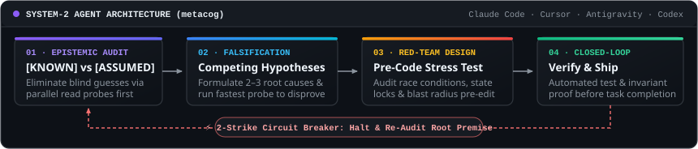

<h1 align="center">Hi 👋, I'm Malay Satapathy</h1>

<p align="center">

</p>

</br>

<h3 align="center">One man’s constant is another man’s variable</h3>

<p align="center">
  <a href="https://about.google/"></a>
  <a href="https://github.com/malay-satapathy/metacog"></a>
  <a href="https://github.com/malay-satapathy"></a>
</p>

- 🔭 **Product Deployed Engineer at [Google](https://about.google/)** — working across applied AI, product strategy, and production engineering.
- 🧠 Obsessed with **why frontier models break on step 18 of a tool chain**—and building lightweight cognitive scaffolding to stop them from thrashing.
- ⚡ Defaulting to **`<1ms` client-side execution**, **on-device models (`window.ai`)**, and **serverless WebRTC P2P** whenever a backend isn't needed.
- 💬 Ask me about **Agentic Systems, System Design, Product Strategy, Travel, Food** — or send your best **memes** 🎃.

---

### 🧩 How I Wire Autonomous Agents (`System-1` → `System-2`)

<p align="center">
  <a href="https://github.com/malay-satapathy/metacog">
    
  </a>
</p>

```bash
# Plug my 100-line System-2 protocol into Claude Code, Antigravity, Cursor, or Codex:
git clone https://github.com/malay-satapathy/metacog.git && ./metacog/install.sh
```

---

### 📦 Selected Builds

<table width="100%">
  <tr>
    <td width="50%" valign="top">
      <strong>🧠 <a href="https://github.com/malay-satapathy/metacog">metacog</a></strong> &nbsp;<code>SKILL.md · MCP · System-2</code>
      <p>Coding agents rarely fail from lack of syntax knowledge—they fail by tweaking the same broken line 5× in a row. Wires <code>[KNOWN]</code> vs <code>[ASSUMED]</code> calibration and a <strong>2-strike circuit breaker</strong> into any coding agent.</p>
      <a href="https://github.com/malay-satapathy/metacog"></a>
      <a href="https://github.com/malay-satapathy/metacog#-quick-install-10-seconds"></a>
    </td>
    <td width="50%" valign="top">
      <strong>🔥 <a href="https://github.com/malay-satapathy/circle-of-shaq">circle-of-shaq</a></strong> &nbsp;<code>WebRTC P2P · Zero-Leak</code>
      <p>Opened <code>spyfall.co</code>'s network tab on game night and spotted <code>is_spy: true</code> leaking in plaintext JSON. Rebuilt with a <strong>zero-leak role engine</strong>, anti-screen-tell UI, serverless P2P sync, and a <em>Desi Adda &amp; Shaadi</em> deck (3–24+ players).</p>
      <a href="https://malay-satapathy.github.io/circle-of-shaq/"></a>
      <a href="https://github.com/malay-satapathy/circle-of-shaq"></a>
    </td>
  </tr>
  <tr>
    <td width="50%" valign="top">
      <strong>✨ <a href="https://github.com/malay-satapathy/delim">delim</a></strong> &nbsp;<code>&lt;1ms · Gemini Nano · SQL</code>
      <p>Replaced ad-heavy server tools with a <strong>100% client-side data studio</strong>: auto-predicts transforms in <code>&lt;1ms</code>, runs <code>pandas</code> &amp; BigQuery/Postgres/Oracle SQL chunking, and bridges to Chrome's on-device <strong>Gemini Nano (<code>window.ai</code>)</strong>.</p>
      <a href="https://malay-satapathy.github.io/delim/"></a>
      <a href="https://github.com/malay-satapathy/delim"></a>
    </td>
    <td width="50%" valign="top">
      <strong>🕹️ <a href="https://github.com/malay-satapathy/play-deck">play-deck</a></strong> &nbsp;<code>22 Games · Plugin Core</code>
      <p><strong>22 classic &amp; indie arcade games</strong> (<em>Tetra-Drop</em>, <em>Maze-Muncher</em>, <em>Merge the Stack</em>, <em>Quantum Dice</em>) architected as isolated zero-collision modules sharing a single cross-game XP progression store.</p>
      <a href="https://malay-satapathy.github.io/play-deck/"></a>
      <a href="https://github.com/malay-satapathy/play-deck"></a>
    </td>
  </tr>
</table>

> **More Playgrounds:** &nbsp;🌞 **[threejs_react](https://malay-satapathy.github.io/threejs_react/)** *(Live 3D WebGL & Physics Demo ↗)* &nbsp;·&nbsp; 🌦️ **[clime_weather_app](https://malay-satapathy.github.io/clime_weather_app/)** *(Live React Weather App ↗)* &nbsp;·&nbsp; 🔐 **[PassKeeper](https://github.com/malay-satapathy/PassKeeper)** *(Native Android Vault)*

---

### 🛠️ Stack & Ecosystem

<p align="left">
  
  
  
  
  
  
  
  
</p>

<p align="left">
  
</p>

---

### 🌐 Connect & Reach Out

<p align="left">
  <a href="https://linkedin.com/in/malaysatapathy" target="_blank">
    
  </a>
  <a href="https://dev.to/malaysatapathy" target="_blank">
    
  </a>
  <a href="mailto:satapathymalay.95@gmail.com">
    
  </a>
  <a href="https://instagram.com/malaysatapathy" target="_blank">
    
  </a>
  <a href="https://fb.com/malaysatapathy" target="_blank">
    
  </a>
  
</p>
