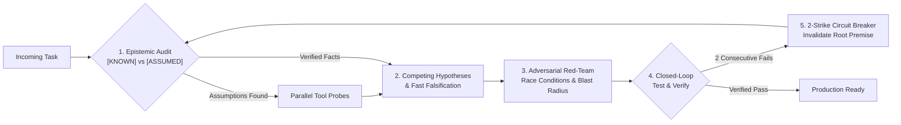

<h1 align="center">Hi 👋, I'm Malay Satapathy</h1>

 

<h3 align="center">One man’s constant is another man’s variable</h3>

  
  
  

- 🔭 **Product Deployed Engineer at [Google](https://about.google/)** — shipping at the intersection of applied AI, product strategy, and production systems.
- 🧠 Obsessed with **why frontier models break on step 18 of a tool chain** (and building lightweight cognitive scaffolding to stop them from thrashing).
- ⚡ Defaulting to **`<1ms` client-side execution**, **on-device models (`window.ai`)**, and **serverless WebRTC P2P** whenever a backend isn't needed.
- 💬 Ask me about **Agentic Architectures, System Design, Product Strategy, Travel, Food** — or send your best **memes** 🎃.

---

### 📦 Selected Builds

| Project | The Story & Architecture | Live / Repo |
| :--- | :--- | :--- |
| **🧠 [metacog](https://github.com/malay-satapathy/metacog)** | Coding agents don't fail from lack of syntax knowledge—they fail by tweaking the same broken fix 5× in a row. A 100-line **System-2 execution protocol (`SKILL.md`)** with `[KNOWN]` vs `[ASSUMED]` calibration & a **2-strike circuit breaker**. |  |
| **🔥 [circle-of-shaq](https://github.com/malay-satapathy/circle-of-shaq)** | Opened `spyfall.co`'s network tab on game night and found `is_spy: true` leaking in plaintext JSON. Rebuilt with a **zero-leak role engine**, anti-screen-tell UI, **serverless WebRTC P2P**, and a *Desi Adda & Shaadi* deck (3–24+ players). |  |
| **✨ [delim](https://github.com/malay-satapathy/delim)** | Replaced ad-heavy server tools with a **`<1ms` 100% in-browser data studio**: auto-predicts transforms on paste, runs `pandas` & BigQuery/Postgres/Oracle SQL chunking, and bridges to Chrome's on-device **Gemini Nano (`window.ai`)**. |  |
| **🕹️ [play-deck](https://github.com/malay-satapathy/play-deck)** | **22 arcade & indie games** (*Tetra-Drop*, *Maze-Muncher*, *Merge the Stack*, *Quantum Dice*) engineered as zero-collision isolated plugins sharing a single cross-game XP state machine. |  |
| **🌞 [threejs_react](https://github.com/malay-satapathy/threejs_react)** | Interactive 3D WebGL & physics sandbox built with `Three.js`, `@react-three/fiber`, `drei`, and `cannon.js`. |  |

---

### 🧩 How I Wire Autonomous Agents (`System-1` → `System-2`)

---

### 🛠️ Stack & Ecosystem

**AI, Agents & Cloud Data**

  
  
  
  
  
  
  
  
  
  

**Frontend, Interactive 3D & Client-Side Architecture**

  
  
  
  
  
  
  
  
  
  
  
  

**Backend, Mobile, Databases & DevOps**

  
  
  
  
  
  
  
  
  
  
  
  
  
  

---

### 🌐 Connect & Reach Out

  
  
  
  
  
  

