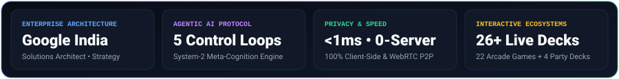

<h1 align="center">Hi 👋, I'm Malay Satapathy</h1>

 

<h3 align="center">One man’s constant is another man’s variable</h3>

  
  
  

  
  
  
  
  
  

 

  

---

## 🚀 Flagship Engineering & Product Showcase

<table width="100%">
  <tr>
    <td width="50%" valign="top">
      
        
      <strong>The System-2 Meta-Cognitive Execution Engine for AI Coding Agents</strong>
       
      Zero-dependency cognitive protocol (<code>SKILL.md</code>) for Claude Code, Cursor, Antigravity, Windsurf &amp; Codex that stops AI agents from guessing and thrashing:
      <ul>
        <li><strong>2-Strike Circuit Breaker:</strong> Halts broken fix loops and invalidates flawed root premises automatically.</li>
        <li><strong>Epistemic Calibration:</strong> Separates <code>[KNOWN]</code> facts from <code>[ASSUMED]</code> guesses before touching code.</li>
        <li><strong>Adversarial Red-Team:</strong> Stress-tests system designs against race conditions &amp; blast radius pre-implementation.</li>
      </ul>
      

        
        
      

    </td>
    <td width="50%" valign="top">
      
        
      <strong>Zero-Touch, 100% In-Browser Data &amp; List Transformation Studio</strong>
       
      Apple-inspired, privacy-first developer studio with zero servers, zero telemetry, and sub-millisecond intent synthesis:
      <ul>
        <li><strong>Zero-Touch Intent Deck &amp; <code>⌘K</code> Conduit:</strong> Auto-profiles pasted datasets in <code>&lt;1ms</code> with 1-click clipboard transforms.</li>
        <li><strong>Universal Natural Language Wand (<code>🪄</code>):</strong> Multi-step plain-English pipelines with Chrome On-Device <strong>Gemini Nano</strong> fallback.</li>
        <li><strong><code>pandas</code> &amp; SQL Dialect Engine:</strong> 4 studio modes (Delimiter, Set Diff, Templates, Column Slicer) + BigQuery/Postgres/Oracle chunking.</li>
      </ul>
      

        
        
      

    </td>
  </tr>
  <tr>
    <td width="50%" valign="top">
      
        
      <strong>Next-Gen Serverless P2P Social Deduction Game (3–24+ Players)</strong>
       
      Engineered after reverse-engineering <code>spyfall.co</code> to eliminate 12 critical security, network-leak, and gameplay loopholes:
      <ul>
        <li><strong>Zero-Leak Role Architecture:</strong> Strips secret spy state from public room payloads &amp; unifies player screens to eliminate physical screen-tells.</li>
        <li><strong>High-Stakes Mechanics:</strong> Blind Majority Voting, mid-round <em>Blow Cover</em> spy steal, <em>Shaq Siren</em> accusation clock, and turn tracking.</li>
        <li><strong>Serverless Multi-Device Sync:</strong> WebRTC P2P (<code>PeerJS</code>) + <code>BroadcastChannel</code> + 4 curated decks including <em>Desi Adda &amp; Shaadi</em>.</li>
      </ul>
      

        
        
      

    </td>
    <td width="50%" valign="top">
      
        
      <strong>Enterprise-Grade Modular Web Arcade Ecosystem (22 Games)</strong>
       
      A unified glassmorphic gaming platform housing 22 encapsulated arcade, puzzle, and indie originals under a single plugin architecture:
      <ul>
        <li><strong>Isolated Plugin Architecture:</strong> Each game runs as a zero-collision encapsulated module with scoped CSS Modules.</li>
        <li><strong>Global XP &amp; Cross-Game Progression:</strong> Centralized <code>GlobalContext</code> store tracks player XP, levels, and stats across all 22 titles.</li>
        <li><strong>Adaptive Cross-Device Controls:</strong> Automatic desktop keyboard bindings and mobile touch DPAD/gesture rendering.</li>
      </ul>
      

        
        
      

    </td>
  </tr>
</table>

### 🧪 More Open-Source Explorations & Creative Tech

<table width="100%">
  <tr>
    <td width="33.3%" valign="top">
      <strong>🌞 <a href="https://github.com/malay-satapathy/threejs_react">threejs_react</a></strong> 
      Interactive 3D WebGL playground built with <strong>Three.js</strong>, <code>@react-three/fiber</code>, <code>drei</code>, and <code>cannon.js</code> physics.  
      
      
    </td>
    <td width="33.3%" valign="top">
      <strong>🌦️ <a href="https://github.com/malay-satapathy/clime_weather_app">clime_weather_app</a></strong> 
      Minimalistic, responsive real-time weather and climate forecasting web application crafted with <strong>React</strong>.  
      
      
    </td>
    <td width="33.3%" valign="top">
      <strong>🔐 <a href="https://github.com/malay-satapathy/PassKeeper">PassKeeper</a></strong> 
      Native Android password management vault engineered with <strong>Java</strong>, Gradle, and clean Material UI patterns.  
      
      
    </td>
  </tr>
</table>

---

## 🛠️ Technology Radar & Engineering Arsenal

<table width="100%">
  <thead>
    <tr>
      <th align="left" width="28%">Domain</th>
      <th align="left" width="42%">Core Stack &amp; Ecosystem</th>
      <th align="left" width="30%">Visual Stack</th>
    </tr>
  </thead>
  <tbody>
    <tr>
      <td><strong>🧠 AI, Cloud &amp; Data Architecture</strong></td>
      <td>
        <code>Google Cloud (GCP)</code> • <code>BigQuery</code> • <code>AWS</code> • <code>Agentic Workflows (SKILL.md / MCP)</code> • <code>On-Device AI (Gemini Nano)</code> • <code>Kubernetes</code>
      </td>
      <td>
        
      </td>
    </tr>
    <tr>
      <td><strong>⚡ Frontend, Creative 3D &amp; UI</strong></td>
      <td>
        <code>React</code> • <code>TypeScript</code> • <code>JavaScript (ES6+)</code> • <code>Next.js</code> • <code>Three.js / R3F</code> • <code>Redux</code> • <code>HTML5 / CSS3 / SCSS</code> • <code>Vite</code> • <code>Figma</code>
      </td>
      <td>
        
      </td>
    </tr>
    <tr>
      <td><strong>🏗️ Backend, Mobile &amp; Databases</strong></td>
      <td>
        <code>Java</code> • <code>Spring Boot</code> • <code>Node.js</code> • <code>Express</code> • <code>Android SDK</code> • <code>NativeScript</code> • <code>MongoDB</code> • <code>MySQL</code> • <code>PHP</code> • <code>Realm</code>
      </td>
      <td>
        
      </td>
    </tr>
    <tr>
      <td><strong>🔬 DevOps, Quality &amp; Tooling</strong></td>
      <td>
        <code>Git</code> • <code>GitHub Actions</code> • <code>Jest</code> • <code>Vitest</code> • <code>Selenium</code> • <code>Jenkins</code> • <code>Webpack</code> • <code>Babel</code> • <code>Vagrant</code> • <code>Heroku</code>
      </td>
      <td>
        
      </td>
    </tr>
  </tbody>
</table>

---

## 📊 Executive Telemetry & GitHub Activity

  

  
  

 

  

**[💼 Connect on LinkedIn](https://linkedin.com/in/malaysatapathy)** &nbsp;•&nbsp; **[📝 Read on DEV.to](https://dev.to/malaysatapathy)** &nbsp;•&nbsp; **[📫 Email Me](mailto:satapathymalay.95@gmail.com)** &nbsp;•&nbsp; **[📸 Instagram](https://instagram.com/malaysatapathy)**

